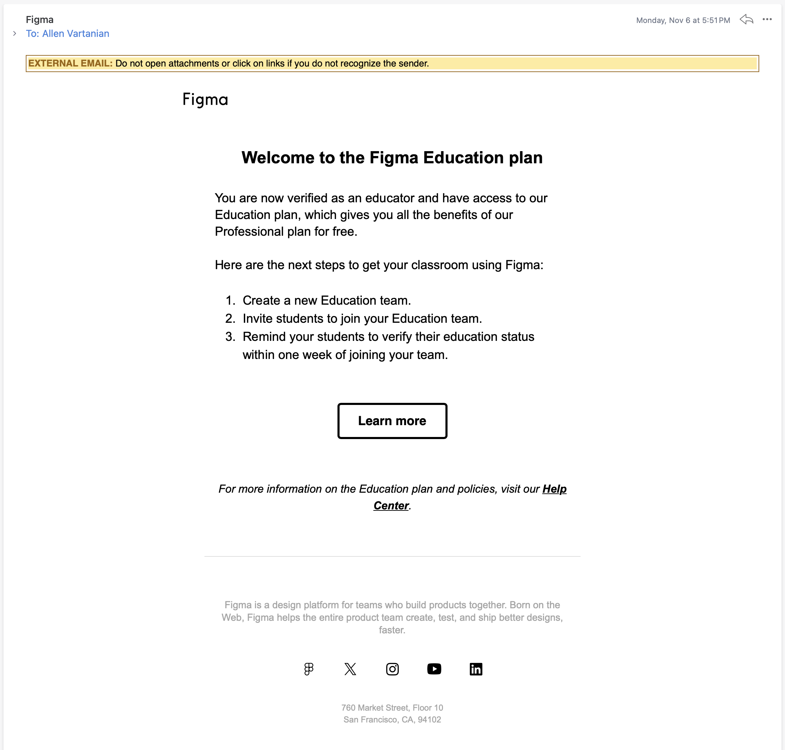

**CMSI 3700** Interaction Design, Fall 2025

# Dream Design

This assignment aims to give you some firsthand experience with the design thinking process, creating an original design that allows you to explore the principles we've learned in class throughout the semester.

## Background Reading

Refer to our previous lectures for information on design thinking, principles, and further resources.
- [Design Thinking Part I](https://www.notion.so/3-Design-Thinking-Part-I-25ad11b8a9a281948837eda8964c1260?pvs=21)
- [Design Thinking Part II](https://www.notion.so/4-Design-Thinking-Part-II-25ad11b8a9a281ff9d74f8a54dfca07d?pvs=21)
- [Design Thinking Part III](https://www.notion.so/5-Design-Thinking-Part-III-25ad11b8a9a2811faf8ffe39daeb5b7e?pvs=21)
- [Principles of Design Part I](https://www.notion.so/6-Principles-of-Design-Part-I-25ad11b8a9a2819fa2bbdc91655491a6?pvs=21)
- [Principles of Design Part II](https://www.notion.so/7-Principles-of-Design-Part-II-25ad11b8a9a281b29eabc6b8d577804f?pvs=21)
- [Usability Evaluation Part I](https://www.notion.so/10-Usability-Evaluation-Part-I-25ad11b8a9a281a6bbc5f9ae26501827?pvs=21)
- [Usability Evaluation Part II](https://www.notion.so/11-Usability-Evaluation-Part-II-25ad11b8a9a2813191e9f0a87c330b56?pvs=21)
- [Affordances](https://avartanii.notion.site/14-Affordances-25ad11b8a9a2815190a2e234d1ff0bee)
- [Design Requirements](https://avartanii.notion.site/16-Design-Requirements-25ad11b8a9a28117bf79c733bd9b72d9?pvs=143)

## For Submission

Create a design for a website or app of your dreams. There are no limits of where your imagination can take you, so run wild with your ideas!

Throughout your usability studies you gained firsthand experience at evaluating the thoughtfulness – or lackthereof – that went into the designs of popular websites and applications. With the intuition you've picked up from observing how your participants interacted with your chosen interfaces, funnel your learnings into creating something that shows the new knowledge you've gained in your experience.

Write a design document, create your design on Figma, and explain your design thinking process in a report. Use [Markdown (`.md`) format](https://guides.github.com/features/mastering-markdown/) for the design document and report.

This will give you experience in the design process, from figuring out an area you want to service, to figuring out how you want to service it, and eventually presenting a design to do just that.

Given the nature of this project with its various stages, we will be approaching this project a little differently. You will have milestones set throughout the span of the full project with due dates you will have to keep up with to ensure you are staying on track.

### Organize Groups

*Due Friday 11/07/2025 @ 11:59pm (5 points)*

You are welcome to work on this solo if you have a passion project you really want to get out there, but you are also allowed to collaborate and work in groups.

We are using an Excel spreadsheet to get organized. Specify your group members. We are targeting groups of four (4) or less; students may belong to only one group. Here is the spreadsheet link:

[Dream Design Groups](https://lmu0-my.sharepoint.com/:x:/g/personal/allen_vartanian_lmu_edu/ER-ZR82Q0dZHgnbTxeo6rqYBPuAGbsgpPjMd_4DSY4iiKw)

It is private, shared only with you through your student email.

**For submission:** Have your group finalized in the spreadsheet

### Create a Figma student account

*Due Friday 11/07/2025 @ 11:59pm (5 points)*

Using [this site](https://www.figma.com/education/), create a student account on Figma. This will enable you to use Figma to its fullest potential for free. You will be creating your designs on Figma so do this step as soon as possible to start learning how to use the software and explore what it has to offer.

**For submission:** Submit screenshots of the email confirming the creation of your account. Upload and commit a screenshot like the following to the folder `/figma-account-screenshots` provided for you in the repository. Every group member must do this for full credit.

Once your groups are finalized and your accounts created, I will send you an invite link to a project on Figma where you will be creating your designs.



### Create a design document

*Due Friday 11/21/2025 @ 11:59pm (20 points)*

Before putting the metaphorical pen to the metaphorical paper, talk through what it is you are trying to achieve. Following the advice on [this page](https://www.freecodecamp.org/news/how-to-write-a-good-software-design-document-66fcf019569c/), create a design document detailing what you are trying to accomplish and produce. A design document template has been provided for you in the repository. The template is a little different from what the site provided describes (i.e. it's a trimmed down version), so when in doubt, follow the template.

[Design Document Template](design-document-template.md)

Your design document should include the following (these are detailed through examples in the template):
- Title of design (name of your site/app)
- Group members
- Overview
- Goals
- Milestones
- Existing designs
- Proposed design
- Open questions/room for improvements

The design document is **not** where you flourish your creative writing. Analogically speaking, write a recipe without the heartfelt story blog post. Keep it simple and straightforward.

**For submission:** Commit your design document to your repository (only one per project/repository).

Once commited, I will read through your document and provide feedback or approval by Monday 11/24/2025 @ 11:59pm.

### Create your design

*Due Sunday 12/07/2025 @ 11:59pm (35 points)*

With your teams creative space assigned to you on Figma, you will then start creating your design. While I encourage you to complete your design document first so that your group is well-informed and agreed upon for what it is you are trying to achieve, I cannot stop you from starting your design creation synchronously with your document (nor will you be marked down for doing so).

Figma is an incredibly powerful tool, so make sure you give yourself time to first learn how to use it to accomplish your goals. By this I mean, take some time to familiarize yourself with its features so you don't end up doing something in a more difficult way when a shortcut or plugin exists for it. You are welcome to use any free plugins, so explore what's out there!

**For submission:** Design **2** separate pages for the same site or app on Figma.

### Write your report

*Due Sunday 12/07/2025 @ 11:59pm (35 points)*

This is where you get to flex your writing skills. Here is where you should let the passion for your design come forward and explain the thoughts and emotions you poured into your process to produce your design. Your report should include the following parts:

[Design Report Template](report-template.md)

- Title of design (name of your site/app)
- Group members
- Backstory
- Inspiration
- Screenshots of designs
- Design process post-mortem
- Relevant usability metrics
- Heuristic description of your design
- Statement of work (for non-solo groups)

#### Backstory

Talk about what has driven you to create this design. What context can you provide about what made you realize a gap in where a certain service needed to be provided or improved that led you to want to address it. You can either be straightforward or really bring on the tearjerker origin story (to go back to the earlier analogy, this is where the blog post about your grandma's special chocolate chip recipe comes in). This project is about your dream design, something you are hopefully passionate about. Communicate that passion in your backstory.

#### Inspiration

Did you draw on any other sources of inspiration in how you approached your design? Talk about them. Give credit where credit is due for your idea incubations. Conversely, if a current existing system is inadequate in your eyes and it inversely inspired you to make a better version, talk about that too!

#### Screenshots of designs and explanation

Export your designs from Figma and include them in your report for ease of reference (as well as to show them off 🙂). Talk me through your designs as you see them and want them to be used. Talk through each page in your design and each element of each page. Explain the story of how you envision users interacting with your site:
- What is supposed to grab their attention?
- What information scents have you left to guide them?
- What colors have you chosen to make your site vibrant, attractive, and usable?
- Have you taken accessibility into account? How? Where?

This is where the passion your started with in your backstory now bubbles over into how you applied it. You will be providing more formal descriptions of design principles etc. in a later section.

#### Design process post-mortem

Provide a synopsis of what your design process was like. Did you go back to the drawing board halfway through because something wasn't working? Did you progress linearly without a single hitch in your process? Did you come to a disagreement in your group that led to a compromise to allow you to move forward? Use this section to reflect on how you got the job done, what worked, what you learned and would do differently next time.

#### Heuristic description of your design

Explore the design heuristics of your own creation. Discuss and detail how you envision your users approaching your design – your mental model of your own design. Hopefully you considered some design principles while coming up with your new creation. Use this section to detail which ones were important to you and your design.

You should also discuss usability metrics here. Your designs are obviously going to be targetted towards a certain audience. As you evaluated the interfaces you chose in your usability study according to certain usability metrics based on the target user population, take this time to detail which usability metrics you considered most important when putting your design together. You should include a description of a minimum of two usability metrics in this section (all 4 are listed below as a refresher).
- *Learnability*
- *Efficiency*
- *Errors*
- *Satisfaction*

### Statement of Work

End your report with a brief summary of what each group member did for the overall study and final report. It goes without saying that you should distribute the work evenly. Allocate a clear, equitable proportion of the overall study and final report to each group member. If you didn’t know it yet, you’re being told now: `git` can measure and track everyone’s contribution by commits and lines of text. Group members that contribute inequitably to the overall work will detract from the final score.

## General Tips

Be as concrete and grounded as possible. For example, you can provide screenshots from your design in multiple parts of your report to illustrate your points. Refer to specific guideline statements or principles. Connect statements about mental models to specific artifacts of your design (screenshots again). Et cetera.

And of course, write clearly, with the appropriate style and voice. Proofread a lot—your score will reflect both what you say and how effectively you say it.

## Specific Point Allocations

| Milestone | Points |
| ---- | ----: |
| Organize group | 5 |
| Create Figma account | 5 |
| Design document | 20 |
| Figma designs | 35 |
| Report | 35 |
| **Total** | **100** |

While not specifically called out in the table above like the previous project, writing assignments are scored with the considerations of *Content* and *Writing*. *Content* pertains to the outcomes listed in the syllabus for writing assignments: you want to demonstrate outcomes *1a*, *1b*, *2a*, and *2b*, up to the concepts that have been covered in class to this point. *Writing* pertains to how well these ideas are expressed, and how cleanly. There is also a certain maturity and professionalism of voice that makes your points more compelling and authoritative. Your voice in this project should be much more formal than what is expected of your weekly design observations and critiques.

### Opportunity for more points

*Due Sunday 12/07/2025 @ 11:59pm*

A twist ending!

There is an opportunity for you to earn more points on this project – but not necessarilly extra credit. If you find yourself far ahead in everything listed above, you are more than welcome to attempt to implement your designs. You can use any method of implementation (barebones front-end HTML/JS/CSS, a framework, Swift, Android Playground, etc.) as long as you provide documentation for how I can download and run your code.

*What's in it for you?*

You can achieve up to *50/50* more points for a full implementation. That said, if you achieve less than 50 points, I will grade your assignment out of that amount. For example, if you earn 35 points on your implementation, your score will be 35/35. This is not direct extra credit, but having more points to pad your grade is to your benefit. This pad will not affect the original score out of 100 of your base project.

For example:  
```
  93/100 on base project  
+ 40/50  on implementation
---------------------------
  133/140 total (aka the base project remains 93/100, and the 40/40 implementation score is added on top of it)

By this math, the project's total score was raised from a 93% to a 95%
``` 

## Wrap Up

At the end of the day, no matter how many principles or theories you follow, design is subjective. I cannot provide a specific rubric as to how I will be grading your designs, but I can tell you that I am looking for apparent thoughtfulness in what you create. That means don't leave it till the last minute and throw something together: it will show, literally. Also, I'm not talking about aesthetic. Your taste in colors, shapes, graphics, and typefaces might be different from mine; that's just reality, and I have to acknowledge it as much as you do. It doesn't matter what your design looks like, it matters how it looks. Is it consistent, does it make sense with itself, is it laid out in a way that encourages users to use it? These are the types of questions I'll be considering when looking at your submissions. Not whether you picked the coolest topic to create a site about, the prettiest graphics to display, or the most pleasing color for your palette.

Be thoughtful. The rest will take care of itself.
